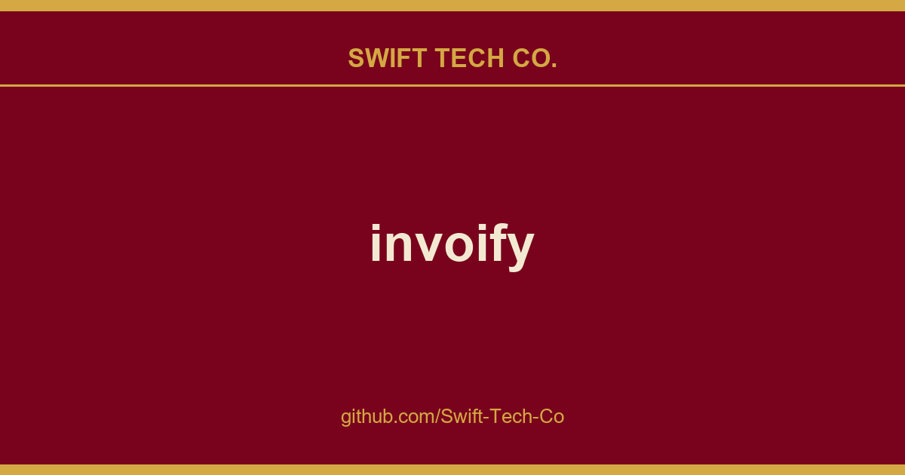

# invoify

## What This Is

We keep a working index for product and engineering, and invoify is the entry that collects our notes, examples and fixes. It reflects how Swift Tech Co. actually uses this in builds and client work.

## Images

[](https://github.com/Swift-Tech-Co/invoify)

## Table of Contents

- [Invoify](#invoify)
  - [Table of Contents](#table-of-contents)
  - [Features](#features)
  - [Your data stays in your browser](#your-data-stays-in-your-browser)
  - [Languages](#languages)
  - [Technologies](#technologies)
    - [Core Technologies](#core-technologies)
    - [Additional Dependencies](#additional-dependencies)
  - [Demo](#demo)
  - [Getting Started](#getting-started)
    - [Prerequisites](#prerequisites)
    - [Installation](#installation)
    - [Environment variables](#environment-variables)
  - [Development](#development)
    - [Scripts](#scripts)
    - [Tests](#tests)
  - [License](#license)
  - [Telegram](#telegram)

## Features

- **13 invoice templates:** Classic, Modern, Sidebar, Bold Header, Minimal, Letterhead, Compact, Two-Tone, Bordered, Left Rail, Statement, Corner and Column.
- **Live preview:** edit the form and watch the invoice update as you type.
- **Real PDFs:** rendered with headless Chromium, not a screenshot of the page.
- **Email delivery:** send the finished PDF straight to your client.
- **Save and reload:** keep invoices in your browser and load them back later.
- **Address book:** save senders and clients once, reuse them on every invoice.
- **Export:** download the invoice data as JSON, CSV or XML.
- **Signatures, logos and custom line items,** including per-invoice tax, discount and shipping.
- **18 languages,** for both the interface and the generated PDF.
- **Responsive:** works on a phone as well as a desktop.

A walkthrough of what each part does lives on the guide page.

## Your data stays in your browser

Invoify has no accounts and no database. Everything you enter (the address book, the autosave draft and your saved invoices) is stored locally, and it is encrypted at rest with AES-GCM 256 under a key the browser generates as non-extractable, so the key cannot be copied out of the origin.

Two things worth being clear about:

- This protects you against someone **reading the browser profile off disk**: a shared or stolen machine, a filesystem backup, a synced profile, another OS account.
- It does **not** protect against a script injected into the page, which holds the same key handle the app does. Defending against that would need a passphrase the app never stores.

The only time invoice data leaves your machine is when you generate a PDF or send one by email, and it is not retained afterwards.

## Languages

Arabic, Azerbaijani, Catalan, Chinese (Simplified), English, French, German, Hebrew, Indonesian, Italian, Japanese, Norwegian (Bokmål), Norwegian (Nynorsk), Polish, Portuguese (Brazil), Serbian, Spanish and Turkish.

Right-to-left layouts are supported for Arabic and Hebrew. Some PDF translations are still incomplete and fall back to English.

## Technologies

### Core Technologies

- **Next.js 15:** React framework for SSR and client-side navigation.
- **TypeScript:** JavaScript superset with static typing.
- **Shadcn-UI:** UI library for enhanced visuals.
- **Tailwind:** Utility-first CSS framework.
- **React Hook Form:** Form management for React.
- **Zod:** TypeScript-first schema validation.
- **Puppeteer:** PDF generation with headless browsers.
- **next-intl:** Internationalized routing and messages.

### Additional Dependencies

- **Nodemailer:** Node.js module for sending emails.
- **Lucide Icons:** Collection of customizable SVG icons.
- **Playwright:** End-to-end tests.

## Demo

> [!NOTE]
> Issue #11 reports PDF generation problems in Mozilla Firefox and is still open. The automated tests run against Chromium only, so the current state in Firefox is untested.

Visit the live demo to see Invoify in action.

## Getting Started

Follow these instructions to get Invoify up and running on your local machine.

### Prerequisites

- Node.js 20 or later, and npm.

### Installation

1. Clone the repository:

   ```bash
   git clone https://github.com/Swift-Tech-Co/invoify
   cd invoify
   ```
2. Install dependencies

   ```bash
   npm install
   ```
3. Create an `.env.local` file. See [Environment variables](#environment-variables) below. You can skip this if you do not need the "send PDF by email" feature.
4. Start development server

   ```bash
   npm run dev
   ```
5. Open your web browser and access the application at https://github.com/Swift-Tech-Co/invoify

### Environment variables

All of these are optional; the app runs without them, minus the features they enable.

| Variable | Required for | Notes |
| --- | --- | --- |
| `NODEMAILER_EMAIL` | Sending invoices by email | The Gmail address that sends the mail. |
| `NODEMAILER_PW` | Sending invoices by email | A Gmail **App Password**, **not** your account password. Requires 2-Step Verification. |

## Development

### Scripts

| Command | What it does |
| --- | --- |
| `npm run dev` | Development server. |
| `npm run build` | Production build. |
| `npm run start` | Serve the production build. |
| `npm run lint` | ESLint. |
| `npm run format` | Prettier, writing in place. |
| `npm run test:e2e` | Playwright end-to-end tests. |
| `npm run test:e2e:ui` | The same tests in Playwright's UI mode. |
| `npm run analyze` | Production build with the bundle analyzer. |
| `npx tsc --noEmit` | Typecheck. |

`predev` and `prebuild` run `scripts/build-pdf-css.mjs`, which compiles the stylesheet the PDF renderer inlines. It runs automatically, so you only need `npm run build:pdf-css` if you change PDF styling and want to rebuild it on its own.

### Tests

```bash
npx playwright install --with-deps chromium
npm run test:e2e
```

The suite builds and serves the production bundle, then runs against it in a desktop and a mobile viewport. CI runs the same typecheck, lint and test steps on every push and pull request. See [`.github/workflows/ci.yml`](.github/workflows/ci.yml).

## License

Distributed under the MIT License. See [`LICENSE`](LICENSE) for more information.

## Telegram
Telegram [here](https://t.me/+Qt_eFvkb2rliMzNh)

---

## Swift Tech Co.

Built and maintained by Swift Tech Co.

AI Automation | FinTech Platforms | Custom Software and Mobile Apps | SaaS Platforms | Cloud Infrastructure | Cybersecurity | SEO and Marketing | API Integration

**Join our community on Telegram:** [t.me/+Qt_eFvkb2rliMzNh](https://t.me/+Qt_eFvkb2rliMzNh)

Home | Services | Careers | Referral Program | Influencers | About | Contact

**Connect**

- Website: https://github.com/Swift-Tech-Co/invoify
- LinkedIn: [linkedin.com/in/stephenoladoke](https://www.linkedin.com/in/stephenoladoke/)
- LinkedIn (Company): [linkedin.com/company/swift-tech-co](https://www.linkedin.com/company/swift-tech-co)
- X: [@MrOladoke](https://x.com/MrOladoke)
- Instagram: [@mr.oladoke](https://www.instagram.com/mr.oladoke/)
- Organization: [github.com/Swift-Tech-Co](https://github.com/Swift-Tech-Co)

## Sources

Compiled and maintained from upstream [al1abb/invoify](https://github.com/al1abb/invoify) under permissive open-source license.

---

Maintained by [Swift Tech Co.](https://github.com/Swift-Tech-Co) - [Telegram](https://t.me/+Qt_eFvkb2rliMzNh)

## Sources

Compiled and maintained from upstream [al1abb/invoify](https://github.com/al1abb/invoify) under permissive open-source license.

---

Maintained by [Swift Tech Co.](https://github.com/Swift-Tech-Co) - [Telegram](https://t.me/+Qt_eFvkb2rliMzNh)

## Sources

Compiled and maintained from upstream [al1abb/invoify](https://github.com/al1abb/invoify) under permissive open-source license.

---

Maintained by [Swift Tech Co.](https://github.com/Swift-Tech-Co) - [Telegram](https://t.me/+Qt_eFvkb2rliMzNh)